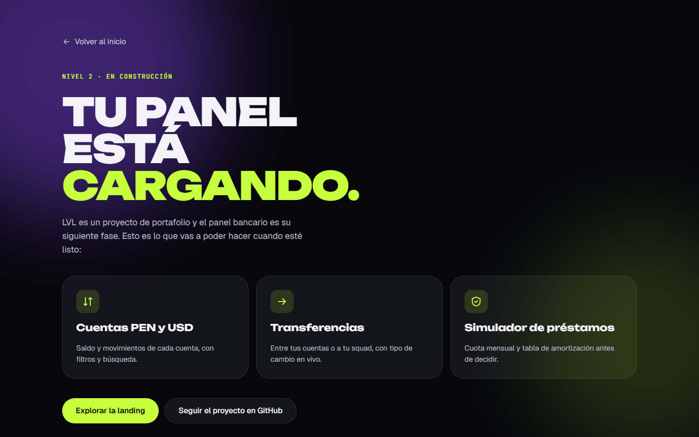

# LVL — Billetera digital para gamers

[](https://github.com/Fufexo/lvl-wallet/actions/workflows/ci.yml)

Landing de una billetera digital ficticia para gamers en Perú: pagos en soles y dólares, XP por cada compra y cashback que sube con tu nivel.

**Demo en vivo → [lvl-wallet.vercel.app](https://lvl-wallet.vercel.app)**


<p align="center">
  
</p>

> Proyecto de portafolio. LVL es una marca ficticia; ningún dato es real.

## Qué tiene

- **Hero animado** con titular revelado palabra por palabra (GSAP SplitText) y tarjeta de producto con inclinación 3D que sigue al cursor.
- **Tipo de cambio en vivo** USD → PEN desde una API pública, y un **conversor interactivo** que lo usa.
- **Bento grid** de funciones, cifras con conteo animado y secciones que aparecen al hacer scroll, con scroll suave (Lenis).
- **Navegación móvil accesible**: botón con `aria-expanded`, cierre con <kbd>Esc</kbd> y retorno del foco.
- Página `/app` que anticipa la siguiente fase del proyecto: el panel bancario.

## Stack

| | |
|---|---|
| Framework | Angular 22 — componentes standalone, signals, zoneless |
| Renderizado | SSR con prerender a HTML estático (`outputMode: "static"`) e hidratación con replay de eventos |
| Estilos | Tailwind CSS v4 con tokens de diseño en `@theme` |
| Animación | GSAP 3 (ScrollTrigger, SplitText) + Lenis |
| Tests | Vitest |
| Deploy | Vercel |

## Decisiones técnicas

- **Prerender + animación sin parpadeo.** El HTML llega completo desde el build, así que el contenido se ve y se indexa sin JavaScript. Todo el código de GSAP y Lenis corre en `afterNextRender`, nunca en el servidor. Para que el hero no "aparezca, desaparezca y se anime" al hidratar, un script mínimo en `index.html` lo oculta antes del primer pintado; si el JavaScript no carga, un respaldo en CSS lo muestra igual.
- **Movimiento reducido de verdad.** Con `prefers-reduced-motion` no se inicializa Lenis, no se crean animaciones y se anulan transiciones y keyframes. Solo se animan `transform` y `opacity`.
- **Datos en vivo solo en el navegador.** El tipo de cambio se pide con `httpResource` únicamente en el cliente, para que la página prerenderizada nunca congele un valor viejo.
- **Sistema de diseño en tokens.** Colores, radios y sombras viven en `@theme`. Las piezas repetidas son primitivos reutilizables en `shared/ui`: `Icon`, `ProgressBar` (con `aria-valuetext`) y la directiva `appButton`, que estiliza un `<a>` sin perder su semántica de enlace.
- **SEO por ruta.** Título y descripción para buscadores y redes (Open Graph con imagen), `canonical` solo en la landing y `noindex` en `/app`, escritos durante el prerender. `robots.txt` y `sitemap.xml` incluidos.
- **Componentes pequeños.** Cada sección de la landing es un componente y las piezas con lógica (conversor, tarjeta de saldo, chip del tipo de cambio) están aisladas y reciben sus datos por inputs, listas para reutilizarse en el panel.

## Calidad

Medido sobre el sitio en producción con Lighthouse 12:

| | Rendimiento | Accesibilidad | Buenas prácticas | SEO |
|---|:---:|:---:|:---:|:---:|
| Móvil | 93 | 100 | 100 | 100 |
| Escritorio | 99 | 100 | 100 | 100 |

- **axe-core** (WCAG 2.2 AA + buenas prácticas): 0 violaciones en `/` y `/app`.
- CLS ≈ 0 en ambos perfiles.

## Estructura

```
src/app/
├── core/
│   ├── exchange-rate.ts      # tipo de cambio en vivo (httpResource)
│   └── motion/               # useGsap, SmoothScroll (Lenis), directivas appReveal y appCountUp
├── shared/ui/                # Icon, ProgressBar, appButton
└── features/
    ├── landing/
    │   ├── landing.ts
    │   ├── sections/         # una sección por archivo
    │   └── components/       # conversor, tarjeta de saldo, chip del tipo de cambio
    └── app-preview/          # /app — adelanto del panel
```

## Correr el proyecto

Requiere **Node 24.15 o superior**.

```bash
npm ci
npm start          # servidor de desarrollo en http://localhost:4200
npm test           # tests unitarios
npm run build      # build de producción + prerender en dist/lvl/browser
```

## Próxima fase

El panel bancario en `/app`, que hoy muestra un adelanto:

- Cuentas en PEN y USD con movimientos, filtros y búsqueda.
- Transferencias con validación (Signal Forms) y tipo de cambio en vivo.
- Simulador de préstamos con cuota mensual y tabla de amortización.



## Autor

**Fufexo** — [github.com/Fufexo](https://github.com/Fufexo)
