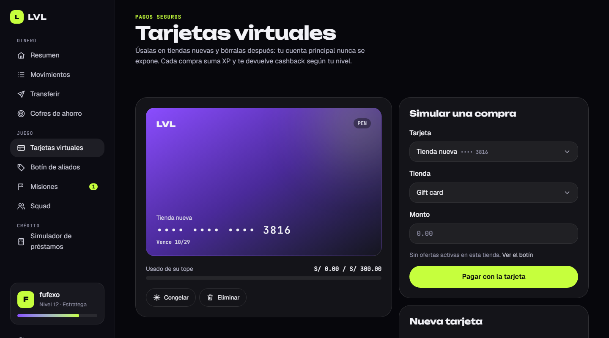
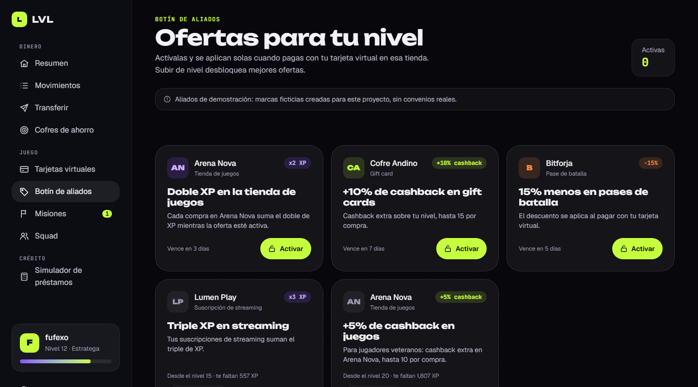

# LVL — Billetera digital para gamers

[](https://github.com/Fufexo/lvl-wallet/actions/workflows/ci.yml)

Billetera digital ficticia para gamers en Perú: una landing animada y un panel bancario de demo con cuentas en soles y dólares, transferencias con tipo de cambio en vivo, tarjetas virtuales, ofertas que se desbloquean por nivel, misiones semanales, cofres de ahorro y un simulador de préstamos que premia tu nivel.

**Demo en vivo → [lvl-wallet.vercel.app](https://lvl-wallet.vercel.app)** · En [/ingresar](https://lvl-wallet.vercel.app/ingresar) eliges cómo entrar al panel:

- **Probar demo:** cualquier gamertag, sin contraseña; los datos de ejemplo viven en tu navegador.
- **Cuenta real:** registro e ingreso contra la [API de LVL](https://github.com/Fufexo/lvl-api) (Spring Boot); tus saldos, movimientos y transferencias se guardan en el servidor.


<p align="center">
  
  &nbsp;&nbsp;
  
</p>

> Proyecto de portafolio. LVL es una marca ficticia; ningún dato es real.

## Qué tiene

### Landing

- **Hero animado** con titular que sube línea por línea desde una máscara (CSS) y tarjeta de producto con inclinación 3D que sigue al cursor (GSAP).
- **Conversor PEN → USD** con tipo de cambio en vivo desde una API pública.
- Bento grid de funciones, cifras animadas y secciones que aparecen con el scroll (Lenis).
- Navegación móvil accesible: `aria-expanded`, cierre con <kbd>Esc</kbd> y retorno del foco.

### Panel (`/app`)

- **Resumen:** saldo total valorizado en soles, cuentas PEN y USD, nivel con barra de XP y cashback, límite mensual de gasto en juegos y últimos movimientos.
- **Movimientos:** filtros por cuenta y categoría, búsqueda que ignora tildes y mayúsculas, agrupación por día y estado vacío con salida. La cuenta se puede preseleccionar desde la URL (`?cuenta=usd`).
- **Transferir:** asistente en tres pasos (datos → confirmar → listo) entre cuentas propias, con conversión en vivo, o a tu squad. Valida saldo y destino, muestra errores junto a cada campo y un resumen enfocable al enviar.
- **Tarjetas virtuales:** crea hasta tres tarjetas desechables con su propio tope, congélalas o elimínalas (con confirmación). Al simular una compra se aplican las reglas de verdad: tope de la tarjeta, límite mensual de juegos y saldo; cada compra suma XP, devuelve cashback según tu nivel y avisa si subiste de nivel.
- **Squad:** paga una suscripción completa, divídela con tu squad y registra quién ya te devolvió su parte. El saldo "por cobrar" se actualiza solo.
- **Botín de aliados:** ofertas de marcas ficticias (doble XP, descuentos, cashback extra) que se desbloquean por nivel y vencen. Al activarlas se aplican solas en la siguiente compra con tarjeta en esa tienda.
- **Misiones semanales:** retos como "Paga 3 veces con tarjeta virtual" o "Guarda S/ 50 en tus cofres". El progreso se calcula desde el historial de movimientos y el XP se reclama con un botón.
- **Cofres de ahorro:** metas con barra de progreso, depósitos y retiros, y redondeo automático: cada compra con tarjeta se redondea y la diferencia cae en el cofre.
- **Simulador de préstamos:** cuota fija (sistema francés) con TEA que baja según tu nivel, gráfico de capital vs. interés por mes y cronograma completo en tabla.






### Dos modos: demo y cuenta real

Con una cuenta real, el resumen, los movimientos y las transferencias vienen de la API: saldos en un libro contable de partida doble, transferencias a otros jugadores por gamertag y reintentos idempotentes. Tarjetas, botín, misiones, cofres y squad siguen en modo demo mientras se migran; en una cuenta real explican eso y ofrecen abrir la demo.

## Stack

| | |
|---|---|
| Framework | Angular 22: componentes standalone, signals, zoneless |
| Formularios | Signal Forms (`@angular/forms/signals`) con validación por schema |
| Renderizado | Prerender estático para las páginas públicas; render en el cliente para el panel |
| Estilos | Tailwind CSS v4 con tokens de diseño en `@theme` |
| Animación | CSS para la intro del hero; GSAP 3 (ScrollTrigger) + Lenis para el resto |
| Tests | Vitest (unitarios), Playwright + axe-core (end-to-end), GitHub Actions |
| Backend | [lvl-api](https://github.com/Fufexo/lvl-api): Java 21 + Spring Boot 4, PostgreSQL |
| Deploy | Vercel (front) · Render + Neon (API) |

## Decisiones técnicas

- **Renderizado híbrido por ruta.** La landing y `/ingresar` se prerenderizan a HTML (se ven y se indexan sin JavaScript). El panel es privado y vive en el navegador, así que se renderiza solo en el cliente, detrás de un guard que recuerda a dónde ibas (`?volver=`) y rechaza destinos fuera de `/app`.
- **Estado con signals, un store por dominio.** `BankStore` (cuentas y movimientos), `CardsStore` y `SquadStore` exponen su estado con `signal`/`computed` y persisten en `localStorage` mediante un `effect`, tolerando almacenamiento bloqueado o SSR. Las tarjetas y el squad no tocan los saldos directamente: registran movimientos a través de `BankStore.record()`, así el historial y los saldos nunca se desincronizan. Las operaciones son asíncronas, con latencia simulada, para que la UI tenga estados de carga reales.
- **Sesión segura con la API.** El access token (JWT de 15 minutos) vive solo en memoria y el refresh token en una cookie `HttpOnly; SameSite=Strict`: un script inyectado no puede leer una credencial duradera. Un interceptor agrega el token, lo renueva al recargar la página o ante un 401 (una sola renovación compartida entre peticiones simultáneas, porque los tokens rotan) y devuelve al ingreso si la sesión ya no es válida. La API se sirve en el mismo dominio (`/api`, con rewrite en Vercel y proxy en desarrollo), así que no hay CORS ni cookies de terceros.
- **Un store, dos fuentes.** `BankStore` mantiene la misma API para las pantallas y elige su fuente según el modo: estado local en la demo, datos del servidor en la cuenta real. Las transferencias reales envían una `Idempotency-Key` por intento; si el usuario reintenta tras un error de red, nunca se cobra dos veces. Los errores del servidor (RFC 9457) llegan con el campo afectado y se muestran junto a él.
- **Servidor que despierta.** La API corre en un plan gratuito que se duerme; si la carga tarda, la interfaz lo explica en lugar de mostrar un spinner mudo.
- **Select propio, accesible y flotante.** Los combobox usan un componente con el patrón WAI-ARIA *select-only combobox* (teclado completo, búsqueda por letra, `aria-activedescendant`). La lista vive en la *top layer* del navegador con la Popover API, así que ningún contenedor la recorta, y se integra con Signal Forms implementando `FormValueControl`.
- **Navegación fluida.** Los cambios de pantalla usan la View Transitions API del navegador (`withViewTransitions`): la barra lateral queda fija y solo el contenido sale y entra. Las pantallas del panel se precargan al entrar a `/app` (estrategia propia, respeta el ahorro de datos), así cambiar de sección no descarga nada. Con movimiento reducido el cambio es instantáneo.
- **Misiones derivadas, no duplicadas.** Cada movimiento guarda su origen (tarjeta, squad, ahorro…) y las misiones calculan su progreso a partir de esos datos; no hay contadores paralelos que puedan desincronizarse.
- **Errores de negocio en el campo.** Cuando una regla rechaza una operación (saldo, tope, límite de juegos), el `submit()` de Signal Forms devuelve el error al campo correspondiente y se muestra igual que cualquier validación.
- **Lógica de negocio pura y testeada.** Amortización, tasas, niveles y formato de montos son funciones puras con sus tests; los componentes solo las muestran.
- **Formularios accesibles.** Cada error se conecta a su campo con `aria-describedby`; si el envío falla aparece un resumen con enlaces a cada campo que recibe el foco. Al cambiar de página o de paso, el foco va al nuevo título.
- **Gráfico sin librerías.** SVG propio con escala de ticks legibles, tooltip al pasar el mouse y resumen textual para lectores de pantalla. La tabla de cronograma es la vista alternativa. La paleta del gráfico se validó para daltonismo y contraste sobre el fondo oscuro.
- **LCP sin depender de JavaScript.** La intro del hero es CSS puro y arranca en el primer pintado; GSAP queda para la inclinación 3D y las animaciones al hacer scroll, siempre en `afterNextRender`, nunca en el servidor. Las fuentes se sirven desde el propio dominio (Fontsource), sin CSS de terceros que bloquee el render.
- **Movimiento reducido de verdad.** Con `prefers-reduced-motion` no hay scroll suave, animaciones ni transiciones.
- **SEO por ruta.** Open Graph con imagen, `canonical` en la landing, `robots.txt` y `sitemap.xml`.

## Calidad

- **59 tests unitarios** (Vitest): préstamos, niveles, stores (transferencias, tarjetas, squad, ofertas, cofres, misiones, persistencia), guard y redirección segura, asistente de transferencia, filtros de movimientos, errores de la API, interceptor (renovación única, reintento tras 401, sesión expirada) y modo cuenta real.
- **14 tests end-to-end** (Playwright) sobre el build de producción: ingreso con guard, transferencia completa, compra con tarjeta que sube de nivel, oferta aplicada, cofre que completa una misión, congelar y eliminar tarjeta, squad, simulador, select solo con teclado, navegación móvil y la cuenta real (registro, saldos del servidor y pago a otro jugador, con la API simulada). El tipo de cambio se simula para que sean deterministas.
- **axe-core** (WCAG 2.2 AA + buenas prácticas) dentro de los tests e2e: 0 violaciones en la landing y las nueve páginas del panel.
- Todo corre en GitHub Actions en cada push.
- **Lighthouse** sobre producción, landing:

| | Rendimiento | Accesibilidad | Buenas prácticas | SEO |
|---|:---:|:---:|:---:|:---:|
| Móvil | 87–98 | 100 | 100 | 100 |
| Escritorio | 100 | 100 | 100 | 100 |

## Estructura

```
src/app/
├── core/
│   ├── session.ts            # sesión de demo + guard requireSession
│   ├── local-store.ts        # localStorage seguro (SSR y modo privado)
│   ├── exchange-rate.ts      # tipo de cambio en vivo (httpResource)
│   ├── seo.ts                # canonical / noindex por ruta
│   └── motion/               # GSAP, Lenis y directivas de animación
├── shared/ui/                # Select, Icon, ProgressBar, FieldError, appButton, pipe money
└── features/
    ├── landing/              # secciones y componentes de la landing
    ├── auth/                 # /ingresar
    └── dashboard/
        ├── data/             # modelos y stores (banco, tarjetas, squad, ofertas, cofres, misiones) + tests
        ├── shell/            # layout: barra lateral y navegación inferior con "Más"
        ├── overview/  movements/  transfer/  cards/  offers/  missions/  savings/  squad/  loans/
        └── ui/               # piezas compartidas del panel
```

## Correr el proyecto

Requiere **Node 24.15 o superior**.

```bash
npm ci
npm start          # servidor de desarrollo en http://localhost:4200
npm test           # tests unitarios
npm run build      # build de producción + prerender en dist/lvl/browser
npm run e2e        # tests end-to-end (después de npm run build)
```

La primera vez que corras los e2e instala el navegador con `npx playwright install chromium`.

En modo demo los datos se guardan en tu navegador; para volver al estado inicial usa **Reiniciar datos de demo** en la barra lateral.

Para la cuenta real en desarrollo, levanta también la [API](https://github.com/Fufexo/lvl-api) en `http://localhost:8080` (`./mvnw spring-boot:run`, con Docker abierto). `npm start` le reenvía `/api` mediante `proxy.conf.json`.

## Próximos pasos

- Migrar a la API tarjetas, botín, misiones, cofres y squad.
- Ingreso con Discord.
- Notificaciones cuando una oferta está por vencer o una misión queda lista.

## Autor

**Fufexo** — [github.com/Fufexo](https://github.com/Fufexo)
