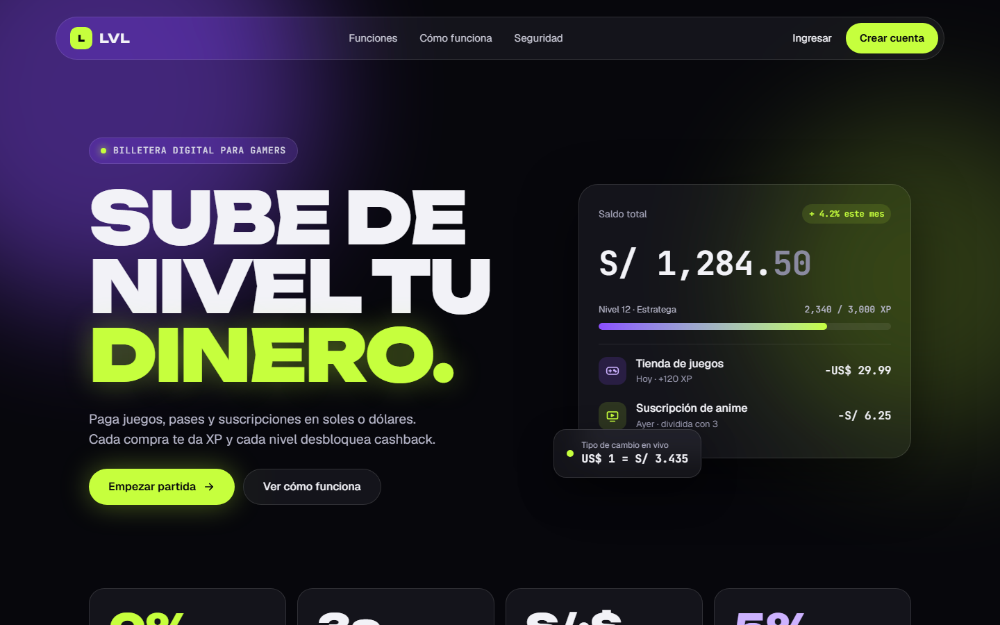
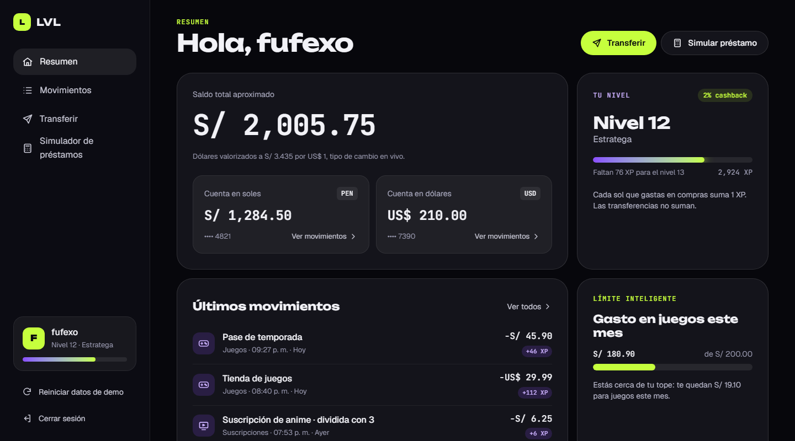
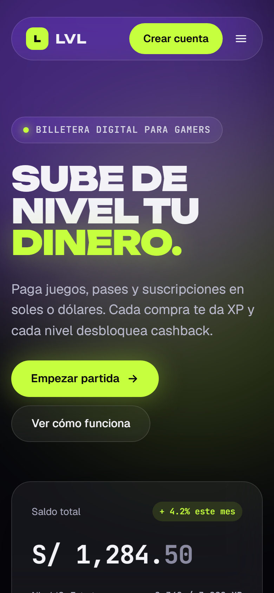
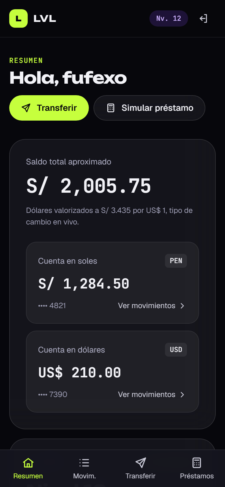
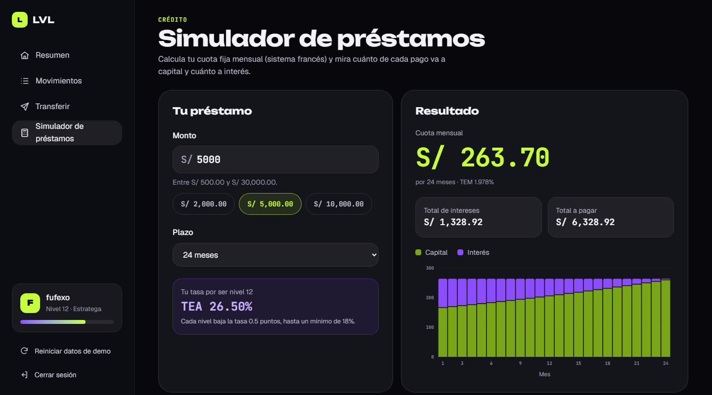

# LVL — Billetera digital para gamers

[](https://github.com/Fufexo/lvl-wallet/actions/workflows/ci.yml)

Billetera digital ficticia para gamers en Perú: una landing animada y un panel bancario de demo con cuentas en soles y dólares, transferencias con tipo de cambio en vivo y un simulador de préstamos que premia tu nivel.

**Demo en vivo → [lvl-wallet.vercel.app](https://lvl-wallet.vercel.app)** · Para el panel, entra en [/ingresar](https://lvl-wallet.vercel.app/ingresar) con cualquier gamertag (no hay contraseñas ni datos reales).





<p align="center">
  
  &nbsp;&nbsp;
  
</p>

> Proyecto de portafolio. LVL es una marca ficticia; ningún dato es real.

## Qué tiene

### Landing

- **Hero animado** con titular revelado palabra por palabra (GSAP SplitText) y tarjeta de producto con inclinación 3D que sigue al cursor.
- **Conversor PEN → USD** con tipo de cambio en vivo desde una API pública.
- Bento grid de funciones, cifras animadas y secciones que aparecen con el scroll (Lenis).
- Navegación móvil accesible: `aria-expanded`, cierre con <kbd>Esc</kbd> y retorno del foco.

### Panel (`/app`)

- **Resumen:** saldo total valorizado en soles, cuentas PEN y USD, nivel con barra de XP y cashback, límite mensual de gasto en juegos y últimos movimientos.
- **Movimientos:** filtros por cuenta y categoría, búsqueda que ignora tildes y mayúsculas, agrupación por día y estado vacío con salida. La cuenta se puede preseleccionar desde la URL (`?cuenta=usd`).
- **Transferir:** asistente en tres pasos (datos → confirmar → listo) entre cuentas propias, con conversión en vivo, o a tu squad. Valida saldo y destino, muestra errores junto a cada campo y un resumen enfocable al enviar.
- **Simulador de préstamos:** cuota fija (sistema francés) con TEA que baja según tu nivel, gráfico de capital vs. interés por mes y cronograma completo en tabla.



## Stack

| | |
|---|---|
| Framework | Angular 22: componentes standalone, signals, zoneless |
| Formularios | Signal Forms (`@angular/forms/signals`) con validación por schema |
| Renderizado | Prerender estático para las páginas públicas; render en el cliente para el panel |
| Estilos | Tailwind CSS v4 con tokens de diseño en `@theme` |
| Animación | GSAP 3 (ScrollTrigger, SplitText) + Lenis |
| Tests | Vitest + GitHub Actions |
| Deploy | Vercel |

## Decisiones técnicas

- **Renderizado híbrido por ruta.** La landing y `/ingresar` se prerenderizan a HTML (se ven y se indexan sin JavaScript). El panel es privado y vive en el navegador, así que se renderiza solo en el cliente, detrás de un guard que recuerda a dónde ibas (`?volver=`) y rechaza destinos fuera de `/app`.
- **Estado con signals.** Un store por dominio (`BankStore`) expone el estado con `signal`/`computed`, persiste en `localStorage` mediante un `effect` y tolera almacenamiento bloqueado o SSR. Las transferencias son asíncronas, con latencia simulada, para que la UI tenga estados de carga reales.
- **Lógica de negocio pura y testeada.** Amortización, tasas, niveles y formato de montos son funciones puras con sus tests; los componentes solo las muestran.
- **Formularios accesibles.** Cada error se conecta a su campo con `aria-describedby`; si el envío falla aparece un resumen con enlaces a cada campo que recibe el foco. Al cambiar de página o de paso, el foco va al nuevo título.
- **Gráfico sin librerías.** SVG propio con escala de ticks legibles, tooltip al pasar el mouse y resumen textual para lectores de pantalla. La tabla de cronograma es la vista alternativa. La paleta del gráfico se validó para daltonismo y contraste sobre el fondo oscuro.
- **Prerender + animación sin parpadeo.** Todo el código de GSAP y Lenis corre en `afterNextRender`, nunca en el servidor. Un script mínimo oculta el hero antes del primer pintado para que no "aparezca y desaparezca" al hidratar. GSAP va en el bundle inicial a propósito: el hero (el elemento LCP) lo necesita para aparecer, y separarlo en otro chunk empeoró el LCP en las mediciones.
- **Movimiento reducido de verdad.** Con `prefers-reduced-motion` no hay scroll suave, animaciones ni transiciones.
- **SEO por ruta.** Open Graph con imagen, `canonical` en la landing, `robots.txt` y `sitemap.xml`.

## Calidad

- **28 tests** (Vitest): cálculo de préstamos, niveles, store de transferencias y persistencia, guard y redirección segura, asistente de transferencia y filtros de movimientos. Corren en CI en cada push.
- **axe-core** (WCAG 2.2 AA + buenas prácticas): 0 violaciones en la landing, `/ingresar` y las cuatro páginas del panel.
- **Lighthouse** sobre producción, landing:

| | Rendimiento | Accesibilidad | Buenas prácticas | SEO |
|---|:---:|:---:|:---:|:---:|
| Móvil | 93 | 100 | 100 | 100 |
| Escritorio | 99 | 100 | 100 | 100 |

## Estructura

```
src/app/
├── core/
│   ├── session.ts            # sesión de demo + guard requireSession
│   ├── local-store.ts        # localStorage seguro (SSR y modo privado)
│   ├── exchange-rate.ts      # tipo de cambio en vivo (httpResource)
│   ├── seo.ts                # canonical / noindex por ruta
│   └── motion/               # GSAP, Lenis y directivas de animación
├── shared/ui/                # Icon, ProgressBar, FieldError, appButton, pipe money
└── features/
    ├── landing/              # secciones y componentes de la landing
    ├── auth/                 # /ingresar
    └── dashboard/
        ├── data/             # modelos, BankStore, préstamos, niveles (+ tests)
        ├── shell/            # layout: barra lateral y navegación inferior
        ├── overview/  movements/  transfer/  loans/
        └── ui/               # piezas compartidas del panel
```

## Correr el proyecto

Requiere **Node 24.15 o superior**.

```bash
npm ci
npm start          # servidor de desarrollo en http://localhost:4200
npm test           # tests unitarios
npm run build      # build de producción + prerender en dist/lvl/browser
```

Los datos del panel se guardan en tu navegador. Para volver al estado inicial usa **Reiniciar datos de demo** en la barra lateral.

## Próximos pasos

- Tests end-to-end con Playwright para los flujos de ingreso y transferencia.
- Pagos con tarjeta virtual desechable y división de suscripciones con el squad.

## Autor

**Fufexo** — [github.com/Fufexo](https://github.com/Fufexo)
